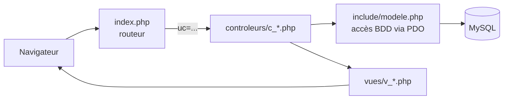

# Épi'Solidaire — Gestion de l'épicerie solidaire de Getcet

Application web PHP qui permet aux agents d'une mairie fictive (Getcet) de gérer une épicerie solidaire : commerces partenaires, bénéficiaires, commandes, stock et produits périmés, avec des droits différents selon le métier de chaque utilisateur.

> Projet réalisé en binôme (Marouane AMEJJOUD et Mathieu). Contexte et données fictifs.


## Problématique

Une épicerie solidaire reçoit des dons de commerces, distribue des produits à des bénéficiaires et doit éviter les pertes liées aux dates de péremption. Sans outil, le suivi des stocks, des commandes et des produits périmés repose sur des fichiers dispersés. L'application centralise ces informations et limite chaque fonctionnalité aux agents concernés.

## Fonctionnalités réalisées

| Métier | Accès |
| --- | --- |
| Secrétaire | Gestion des commerces partenaires (liste, ajout, suppression) |
| Épicier | Acheteurs, commandes, entrées de stock, produits périmés |
| Maire | Accès à l'ensemble des fonctionnalités |
| Tous | Connexion, profil, modification du mot de passe, déconnexion |

Détail :

- **Commandes** : création en magasin ou par téléphone, contrôle du stock disponible et calcul du prix total, suivi du statut (préparée, incomplète, livrée), suppression, export PDF de la liste (FPDF).
- **Stock** : validation des entrées de stock.
- **Périmés** : repérage des produits proches ou au-delà de leur date de péremption, déclaration en don ou en perte.
- **Commerces et acheteurs** : listes, ajout et suppression.

## Architecture

Le projet suit le modèle **MVC** avec un contrôleur frontal :



```text
index.php                 routeur : choisit le contrôleur selon le paramètre uc
controleurs/              logique de chaque domaine (connexion, commandes, stock...)
vues/                     gabarits HTML/PHP
styles/                   feuille de style
generer_pdf_commandes.php export PDF des commandes (réservé épicier / maire)
```

## Prérequis

- PHP et un serveur web (Apache, ou `php -S` en local)
- MySQL / MariaDB
- La bibliothèque FPDF pour l'export PDF

## Installation

> **Important :** le dossier `include/` (classe `Modele`, fonctions de session, FPDF) et le script SQL de la base ne sont pas encore versionnés. L'application ne peut donc pas être lancée depuis ce dépôt en l'état. Ils seront ajoutés avec une configuration sans identifiants (voir « Améliorations prévues »).

Une fois ces fichiers ajoutés :

```bash
git clone https://github.com/Marouane55z/episolidaire-gestion-epicerie.git
cd episolidaire-gestion-epicerie
php -S localhost:8000
```

## Limites connues

- Dossier `include/` et script SQL absents du dépôt.
- Les actions de suppression passent par des liens GET sans jeton anti-CSRF.
- Certaines vues affichent des données sans échappement HTML (`htmlspecialchars`).
- Pas de tests automatisés.

## Améliorations prévues

- Versionner `include/` avec un fichier de configuration d'exemple (`include/config.example.php`) et le script SQL avec des données fictives.
- Échapper systématiquement les sorties HTML et passer les suppressions en POST avec jeton CSRF.
- Ajouter des captures d'écran et une démonstration.

## Documentation complémentaire

- [Analyse fonctionnelle (rétrospective)](docs/analyse-fonctionnelle.md)

## Auteurs

**Marouane AMEJJOUD** — L3 MIAGE, Université Paris-Saclay · [LinkedIn](https://www.linkedin.com/in/marouaneamejjoud/) · [GitHub](https://github.com/Marouane55z)
Mathieu — co-auteur du projet
