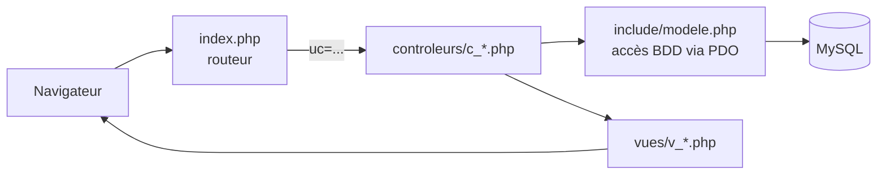

# Épi'Solidaire — Gestion de l'épicerie solidaire de Getcet

Application web PHP qui permet aux agents d'une mairie fictive (Getcet) de gérer une épicerie solidaire : commerces partenaires, bénéficiaires, commandes, stock et produits périmés, avec des droits différents selon le métier de chaque utilisateur.

> Projet réalisé en binôme (Marouane AMEJJOUD et Mathieu). Contexte et données fictifs.


## Problématique

Une épicerie solidaire reçoit des dons de commerces, distribue des produits à des bénéficiaires et doit éviter les pertes liées aux dates de péremption. Sans outil, le suivi des stocks, des commandes et des produits périmés repose sur des fichiers dispersés. L'application centralise ces informations et limite chaque fonctionnalité aux agents concernés.

## Fonctionnalités réalisées

| Métier | Accès |
| --- | --- |
| Secrétaire | Gestion des commerces partenaires (liste, ajout, suppression) |
| Épicier | Acheteurs, commandes, entrées de stock, produits périmés |
| Maire | Accès à l'ensemble des fonctionnalités |
| Tous | Connexion, profil, modification du mot de passe, déconnexion |

Détail :

- **Commandes** : création en magasin ou par téléphone, contrôle du stock disponible et calcul du prix total, suivi du statut (préparée, incomplète, livrée), suppression, export PDF de la liste (FPDF).
- **Stock** : validation des entrées de stock.
- **Périmés** : repérage des produits proches ou au-delà de leur date de péremption, déclaration en don ou en perte.
- **Commerces et acheteurs** : listes, ajout et suppression.

## Architecture

Le projet suit le modèle **MVC** avec un contrôleur frontal :



```text
index.php                 routeur : choisit le contrôleur selon le paramètre uc
controleurs/              logique de chaque domaine (connexion, commandes, stock...)
vues/                     gabarits HTML/PHP
styles/                   feuille de style
generer_pdf_commandes.php export PDF des commandes (réservé épicier / maire)
include/                  modèle PDO, fonctions de session, bibliothèque FPDF
sql/getcet.sql            schéma et données de démonstration
```

## Installation

Aucun identifiant n'est stocké dans le dépôt. La connexion à la base se règle par variables d'environnement `EPI_DB_*`, ou par un fichier `include/config.php` non versionné ; sans réglage, l'application utilise les valeurs d'une installation locale (MySQL sur `localhost`, utilisateur `root` sans mot de passe).

### Option 1 : Docker

```bash
git clone https://github.com/Marouane55z/episolidaire-gestion-epicerie.git
cd episolidaire-gestion-epicerie
docker compose up --build
```

Puis ouvrir http://localhost:8080. La base est créée et remplie automatiquement au premier démarrage.

### Option 2 : XAMPP, WAMP ou MAMP

1. Copier le dossier du projet dans le répertoire web (`htdocs/` pour XAMPP).
2. Importer `sql/getcet.sql` dans phpMyAdmin (onglet **Importer**) ou avec `mysql -u root < sql/getcet.sql`.
3. Ouvrir http://localhost/episolidaire-gestion-epicerie/.

Si votre MySQL n'utilise pas `root` sans mot de passe, copier `include/config.example.php` en `include/config.php` et y renseigner vos paramètres.

### Comptes de démonstration

| Identifiant | Mot de passe | Accès |
| --- | --- | --- |
| `secretaire` | `demo` | Commerces partenaires |
| `epicier` | `demo` | Acheteurs, commandes, stock, périmés |
| `maire` | `demo` | Toutes les fonctionnalités |

Toutes les données sont fictives. Le script SQL a été reconstitué à partir des requêtes de `include/modele.php`, le script d'origine n'ayant pas été conservé ; les dates de péremption sont calculées par rapport au jour de l'import.

## Limites connues

- Les actions de suppression passent par des liens GET sans jeton anti-CSRF.
- Certaines vues affichent des données sans échappement HTML (`htmlspecialchars`).
- Les droits par métier sont appliqués dans le menu, mais pas encore dans tous les contrôleurs (la gestion des commerces reste accessible par URL directe).
- Pas de tests automatisés.

## Améliorations prévues

- Échapper systématiquement les sorties HTML et passer les suppressions en POST avec jeton CSRF.
- Vérifier le métier de l'utilisateur dans chaque contrôleur.
- Ajouter des captures d'écran.

## Documentation complémentaire

- [Analyse fonctionnelle (rétrospective)](docs/analyse-fonctionnelle.md)

## Auteurs

**Marouane AMEJJOUD** — L3 MIAGE, Université Paris-Saclay · [LinkedIn](https://www.linkedin.com/in/marouaneamejjoud/) · [GitHub](https://github.com/Marouane55z)
Mathieu — co-auteur du projet
