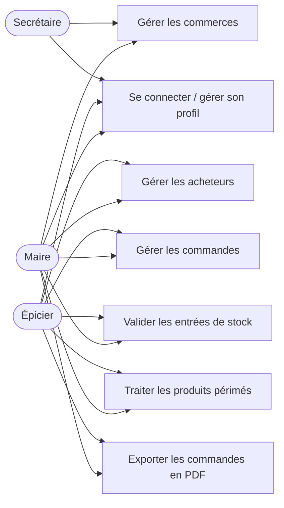
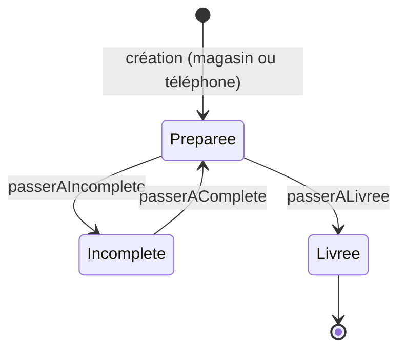

# Analyse fonctionnelle — Épi'Solidaire

> **Documentation rétrospective.** Ce document a été rédigé après la réalisation du projet, à partir du code existant, pour en expliquer le fonctionnement. Il ne décrit que ce qui est implémenté.

## 1. Acteurs

| Acteur | Rôle dans l'organisation | Droits dans l'application |
| --- | --- | --- |
| Secrétaire | Gère les partenaires de l'épicerie | Commerces |
| Épicier | Gère la distribution au quotidien | Acheteurs, commandes, stock, périmés, export PDF |
| Maire | Supervise l'épicerie | Toutes les fonctionnalités |

## 2. Cas d'utilisation

## 3. Cycle de vie d'une commande

Règles de gestion implémentées lors de la création :

- un acheteur doit être sélectionné ;
- au moins un produit doit avoir une quantité supérieure à 0 ;
- la quantité demandée ne peut pas dépasser le stock ; sinon un message indique le produit, la quantité demandée et le stock ;
- le prix total est calculé à partir du prix unitaire et des quantités.

## 4. Traitement des produits périmés

Un produit périmé ou proche de sa date de péremption peut être déclaré **donné** ou **jeté**, ce qui permet de suivre les pertes.

## 5. Exigences non fonctionnelles observées

- Accès protégé par authentification et session.
- Menu et export PDF filtrés selon le métier de l'utilisateur.
- Architecture MVC avec contrôleur frontal (`index.php`).

## 6. Points d'amélioration identifiés

| Risque | Impact | Correction proposée |
| --- | --- | --- |
| Suppressions par liens GET sans jeton | Suppression involontaire ou forgée (CSRF) | Formulaires POST + jeton CSRF |
| Sorties HTML non échappées | Injection de script (XSS) si une donnée est malveillante | `htmlspecialchars()` sur chaque affichage |
| Dossier `include/` et SQL non versionnés | Projet non installable par un tiers | Traité : `include/` versionné sans identifiants, schéma SQL reconstitué avec données fictives |
